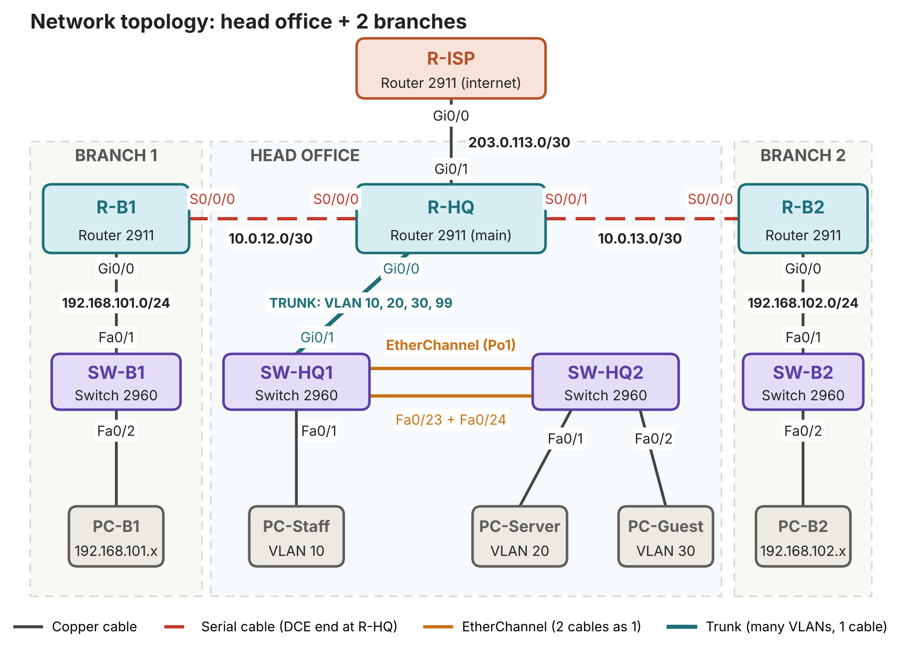
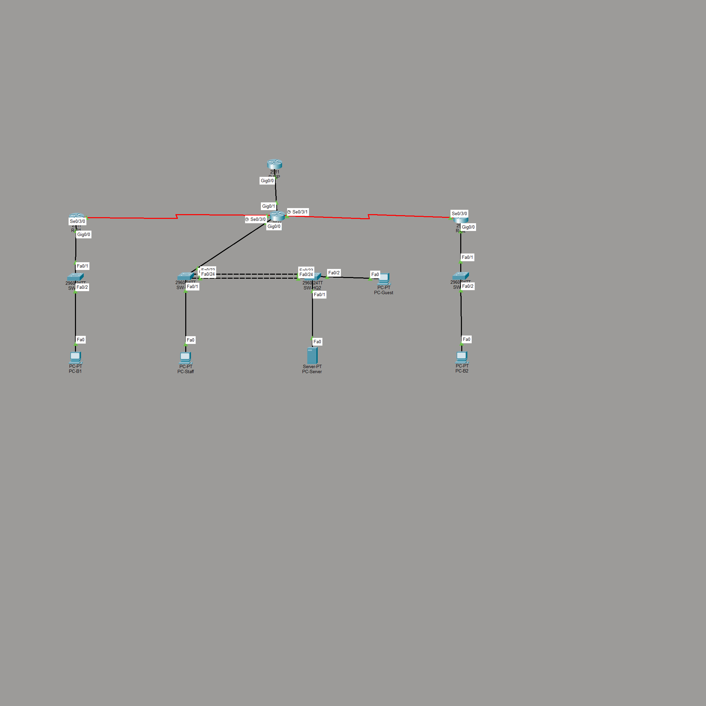
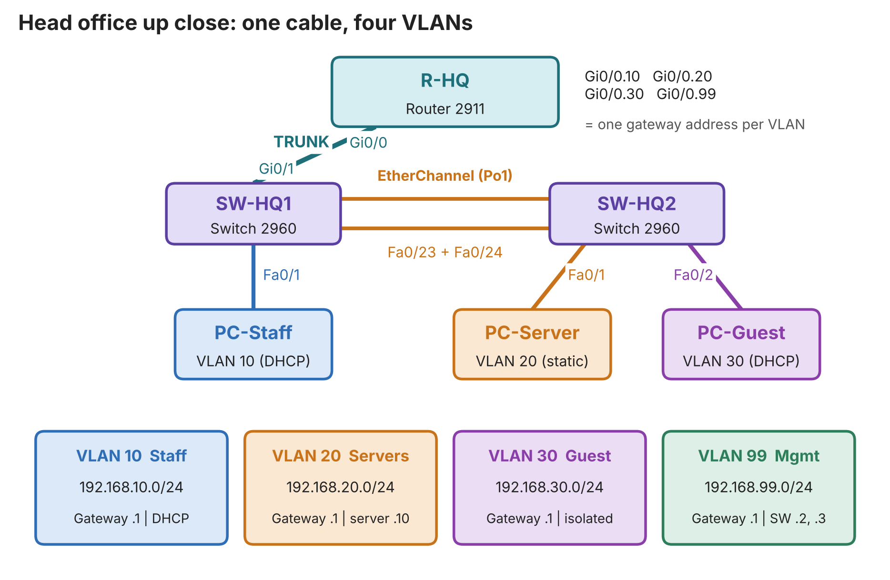

# Secure Multi-Site Enterprise Network (Cisco Packet Tracer)

A three-site company network (head office + 2 branches) that I designed, built, secured and tested in Cisco Packet Tracer while studying for my CCNA.

**Author:** Buddhika Sandaru (M. A. B. S. L. Marasinghe), Information Technology, Institute of Technology, University of Moratuwa
**Tools:** Cisco Packet Tracer, Cisco IOS command line

---

## Goal

Build a small but realistic enterprise network that:

- keeps different user groups apart (Staff, Servers, Guest, Management)
- connects the head office and two branch offices
- gives every device an address automatically where it makes sense
- shares one public address for internet access
- survives the loss of one link between the head office switches
- is protected against common mistakes and attacks at the access layer

## Topology



Packet Tracer topology:



Head office detail (one trunk cable carrying four VLANs):



## What is implemented

| Area | Feature | Where |
|---|---|---|
| Switching | VLANs 10 (Staff), 20 (Servers), 30 (Guest), 99 (Management) | SW-HQ1, SW-HQ2 |
| Switching | 802.1Q trunk, native VLAN 99 | SW-HQ1 to R-HQ |
| Switching | EtherChannel (LACP, 2 links) | SW-HQ1 to SW-HQ2 |
| Routing | Router-on-a-stick (one subinterface per VLAN) | R-HQ |
| Routing | OSPF area 0 with default-route origination | R-HQ, R-B1, R-B2 |
| Services | DHCP for Staff, Guest and both branch LANs | R-HQ, R-B1, R-B2 |
| Services | NAT/PAT (overload) to the simulated internet | R-HQ |
| Security | Guest isolation with an extended ACL | R-HQ (Gi0/0.30) |
| Security | SSH version 2 only, Telnet disabled | all 8 devices |
| Security | Port security (sticky MAC, violation restrict) | head office switches |
| Security | DHCP snooping with trusted uplinks | head office switches |
| Security | Unused ports shut down | all switches |

## Addressing summary

| Network | Subnet | Gateway |
|---|---|---|
| VLAN 10 Staff | 192.168.10.0/24 | 192.168.10.1 |
| VLAN 20 Servers | 192.168.20.0/24 | 192.168.20.1 |
| VLAN 30 Guest | 192.168.30.0/24 | 192.168.30.1 |
| VLAN 99 Management | 192.168.99.0/24 | 192.168.99.1 |
| Branch 1 LAN | 192.168.101.0/24 | 192.168.101.1 |
| Branch 2 LAN | 192.168.102.0/24 | 192.168.102.1 |
| HQ to Branch 1 (serial) | 10.0.12.0/30 | - |
| HQ to Branch 2 (serial) | 10.0.13.0/30 | - |
| HQ to ISP | 203.0.113.0/30 | - |

The full plan with every interface is in [docs/design.md](docs/design.md).

## Repository layout

```
multisite-network/
  README.md
  multisite-network.pkt        <- Cisco Packet Tracer topology and lab file
  configs/                     <- one text file per device
  diagrams/                    <- topology pictures
  docs/
    design.md                  <- requirements, design decisions, IP and VLAN plan
    test-plan.md               <- tests with expected results and evidence
    troubleshooting-log.md     <- problems I hit and how I fixed them
    project-report.md          <- short written report
  screenshots/                 <- evidence for each test
```

## How to run and test

1. Open `multisite-network.pkt` in Cisco Packet Tracer.
2. Wait about a minute for OSPF and the EtherChannel to settle.
3. Follow [docs/test-plan.md](docs/test-plan.md). The most important checks:
   - PC-Staff can ping both branch PCs (OSPF works)
   - Any PC can ping 8.8.8.8 (NAT and default route work)
   - PC-Guest cannot ping PC-Staff but can still reach 8.8.8.8 (ACL works)
   - Telnet is refused and SSH works (device hardening works)
   - Removing one EtherChannel cable does not break connectivity (redundancy works)
4. Device login for the lab: user `admin`. The passwords are lab-only values and are not published in the exported configs.

## Evidence

Screenshots for every test are in [screenshots/](screenshots/). See
[screenshots/README.md](screenshots/README.md) for the list and what each one proves.

## What I learned

- How router-on-a-stick works and why the native VLAN must match on both ends of a trunk
- How OSPF neighbours form and why serial links need a clock on the DCE end
- How to separate guests from internal networks with an ACL and still allow internet access
- How to harden a switch with port security, DHCP snooping and unused-port shutdown
- A method for troubleshooting: check the layer, read the show commands, fix one thing at a time

Details of real problems and fixes: [docs/troubleshooting-log.md](docs/troubleshooting-log.md).

## Possible next steps

- Python automation (Netmiko) to back up all device configurations
- Monitoring with SNMP and Syslog (Zabbix or LibreNMS)
- HSRP for gateway redundancy, a site-to-site VPN, IPv6 dual-stack
